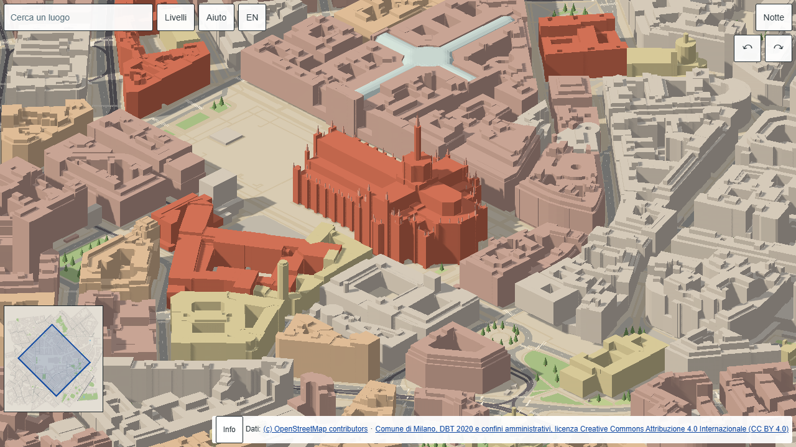

# Milano Iso

An interactive web map of Milan in an isometric, SimCity-like style. The geometry is real: building
footprints and heights, streets, rail, water and green areas come from open data (OpenStreetMap and the
Comune di Milano). Only the look is stylised. It runs in the browser (Three.js, orthographic camera) from
static files: no backend and no call to a third-party map service at run time.



Screenshot: the pilot area around the Duomo from the real tiles, taken for task T-7.2 (see `reports/R-7.2.md`).
The map is Italian by default and can be switched to English (IT/EN button). The `Info` button in the
attribution line opens the About panel: sources, licences, date of the data, build version, repository.

Status and decisions: `docs/PROGRESS.md`, `docs/DECISIONS.md`. Rules for contributors: `CLAUDE.md`.

## Prerequisites

| Tool | Version | Where it comes from |
|---|---|---|
| Python | 3.12 (`>=3.12,<3.13`, `pyproject.toml`) | installed by uv if missing |
| uv | 0.13.8 (the version CI pins, `.github/workflows/ci.yml`) | https://docs.astral.sh/uv/ |
| Node.js | 24 (CI uses 24; the rebuild log used v24.12.0) | https://nodejs.org/ |
| npm | CI pins 11.19.1; the rebuild log used 11.6.2 (the one that ships with Node 24.12.0) | npm |
| GNU Make | 4.x (the rebuild log used 4.4.1) | on Windows use Git Bash with `make` |
| A shell with POSIX syntax | Git Bash, WSL or Linux/macOS | the Makefile uses `test`, `mkdir`, `cp`, `rm` |
| Chromium for Playwright | installed by `npx playwright install chromium` (only for `npm run e2e`) | Playwright 1.65.1, pinned in `web/package-lock.json` |

Python and Node packages are pinned in `uv.lock` and `web/package-lock.json` and installed from them.
The pipeline reads and writes about 1.2 GB of downloads plus the processed data and tiles (see
"Time and disk" below). Free disk space needed for the pilot: see the measured table below.

## Quick start (use the data directory that already exists)

```sh
git clone <this repository> milano-iso && cd milano-iso
make setup                       # uv sync --locked; npm --prefix web ci
```

Then follow "Get the data" and "Build the tiles" below, or skip to "Run it" if you already have
`data/tiles/pilot/` (or a directory pointed to by `MILANO_ISO_DATA`, see below).

## Get the data

Raw data is never committed (`data/` is gitignored). `make data` downloads and processes it:

- OpenStreetMap, Geofabrik extract "Nord-Ovest" (ODbL), about 595 MB;
- Comune di Milano: Database Topografico 2020 (CC BY 4.0), about 597 MB;
- Comune di Milano: administrative boundary (CC BY), about 2 MB.

The exact URLs, licences, dates and checksums are in [`docs/DATA_SOURCES.md`](docs/DATA_SOURCES.md) and
`pipeline/manifests/*.json`. Downloads are skipped when the file is already there and its sha256 matches.

```sh
make data                        # pilot extent (the default); ADR-0035
make data EXTENT=city            # the whole comune
```

`make data` writes `data/raw/` (downloads), `data/interim/` and `data/processed/pilot.gpkg` (or
`city.gpkg`). Every step is deterministic. The directory can be moved: `export MILANO_ISO_DATA=/path/to/dir`
(it must contain `raw/`, `interim/`, `processed/`, `tiles/`).

## Build the tiles

```sh
make tiles                       # data/tiles/pilot/: .glb tiles, feature tables, tiles.json, search index, minimap
make tiles EXTENT=city           # data/tiles/city/ (needs make data EXTENT=city)
make web-tiles EXTENT=pilot      # copies data/tiles/pilot/ to web/public/tiles/pilot/ (the site serves it)
make web-tiles EXTENT=city       # copies data/tiles/city/ to web/public/tiles/city/
```

The site opens the city tileset by default (`?tiles=tiles/pilot/` selects the pilot; ADR-0039). Run
`make web-tiles` for each extent you want to see. Optional checks on the real data: `make validate`
(pilot) and `make check-determinism`; they are not part of `make test`.

## Run it

All `npm` commands run in `web/` (use `npm --prefix web ...` from the repository root).

| Command | What it does and produces |
|---|---|
| `npm run dev` | Vite dev server (http://localhost:5173), hot reload. Serves `web/public/tiles/`. |
| `npm run build` | `vite build`: `web/dist/` (JS, CSS, `index.html`, the copied tiles). |
| `npm run build:prod` | `vite build` and `precompress`: adds `.br` and `.gz` next to every text and tile file. This is what a host should serve (ADR-0038). |
| `npm run serve` | Local static server for `web/dist/` on http://127.0.0.1:4174 (`-- --port N`), serving the `.br`/`.gz` files with the right headers. Needs `npm run build:prod` first. |
| `npm run preview` | Plain `vite preview` on port 4173 (no precompressed files). |
| `npm run typecheck`, `npm run lint`, `npm test` | `tsc --noEmit`, eslint, vitest (unit tests). |
| `npm run e2e` | Playwright end-to-end tests on the built site (`web/dist/`, needs `npm run build` first) with the synthetic fixture tiles, not the real data. Set `E2E_PORT` to use another port than 4173. Needs `npx playwright install chromium` once. |
| `make test` (repository root) | ruff, pytest, and the web typecheck, lint and unit tests. |

Open `http://localhost:5173/?tiles=tiles/pilot/` for the pilot or `/` for the city. Useful parameters:
`?lang=en`, `?time=night`, `?debug`.

## Host requirements

The site is static files. For the real tiles the host must (ADR-0038):

- serve the precompressed brotli files (`x.br`) with `Content-Encoding: br` and `Vary: Accept-Encoding`
  (without brotli the pilot payload is larger; see `docs/DECISIONS.md` ADR-0038 for the budget);
- apply the cache rules in [`web/public/_headers`](web/public/_headers): `no-cache` for the page and
  `tiles.json`, `immutable` for `/assets/*` and `/tiles/*` (tile URLs carry a content hash in `?v=`).

`_headers` is the Netlify and Cloudflare Pages format; GitHub Pages does not read it (`docs/DATA_SOURCES.md`,
"Hosting limits"). The choice of host is recorded in `docs/DECISIONS.md` (ADR-0045 proposed, T-7.0) and is not
decided here. `web/scripts/serve.mjs` implements the same rules locally.

## Time and disk (measured)

TIME_DISK_PLACEHOLDER

## Licences

**The data** keeps the licence of its source. What each licence asks of us, and where, is in
`reports/R-7.2.md` ("Licence obligations"). In short:

| Data | Licence |
|---|---|
| OpenStreetMap contributors | ODbL 1.0, https://www.openstreetmap.org/copyright. "(c) OpenStreetMap contributors" is shown on the map. |
| Comune di Milano, Database Topografico (DBT) 2020 | Creative Commons Attribuzione 4.0 (CC BY 4.0), https://dati.comune.milano.it/dataset/ds2889_database-topografico-dbt-2020-shp |
| Comune di Milano, confini amministrativi | Creative Commons Attribution (CC BY), https://dati.comune.milano.it/dataset/ds2841-confini-amministrativi-del-comune-di-milano |

The tiles built from OpenStreetMap data are treated as a derivative database under the ODbL (ADR-0009).

**The code of this project:** LICENCE_PLACEHOLDER

Third-party libraries keep their own licences (see `uv.lock` and `web/package-lock.json`).
